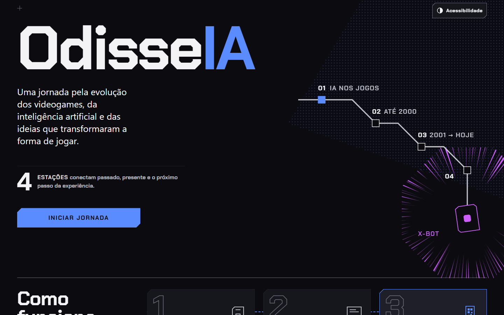
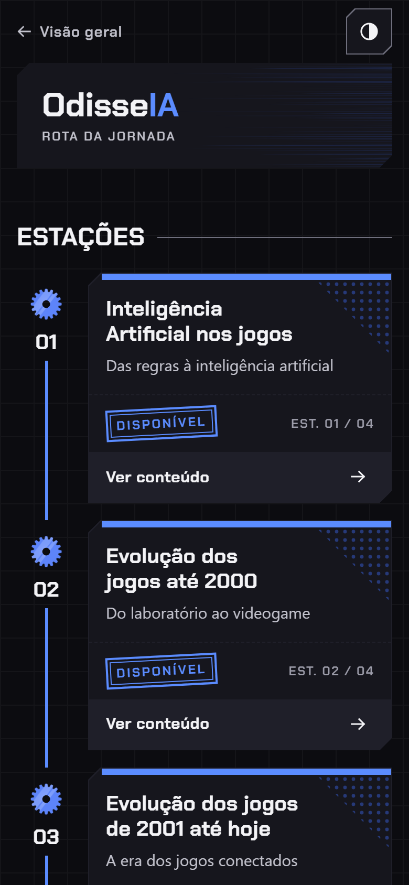
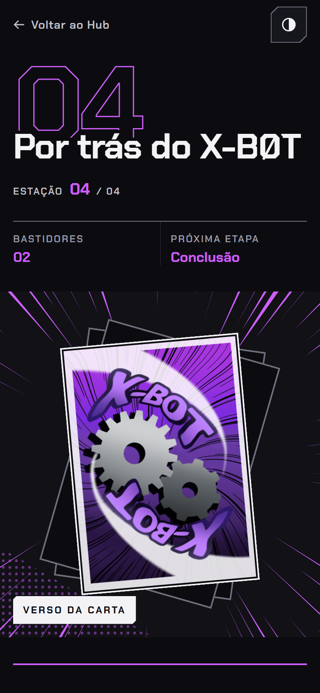
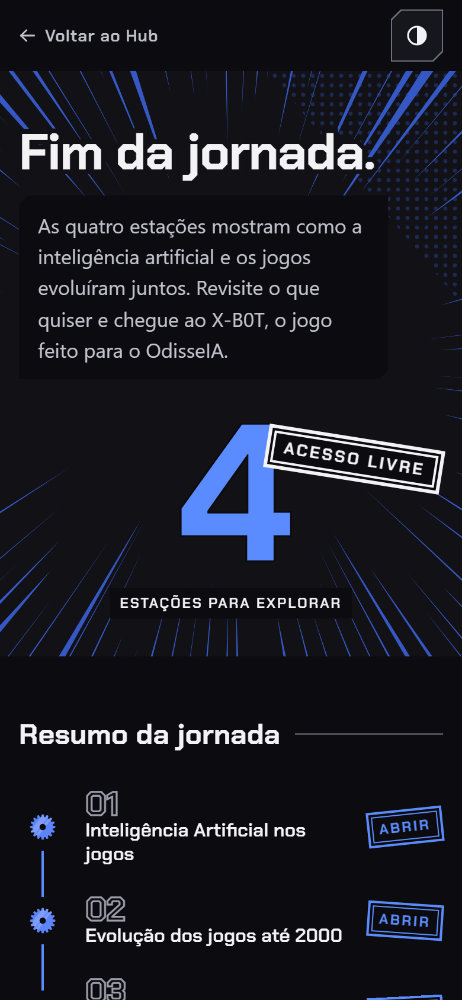
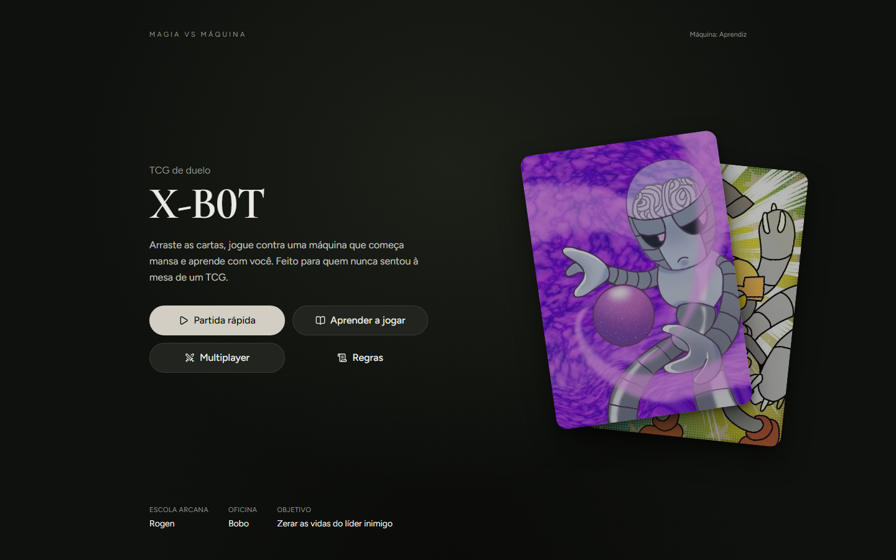

# OdisseIA

O **OdisseIA** é um projeto educacional sobre a evolução da inteligência artificial e a sua relação com os jogos. Ele nasceu para uma feira escolar, com estações físicas e uma parte digital acessada pelo celular dos visitantes, e hoje é um site aberto: qualquer pessoa pode explorar todo o conteúdo, em qualquer ordem.

O site reúne as quatro estações, a Conclusão, o **X-B0T** (um jogo digital desenvolvido por outro grupo do projeto), os Mini Jogos, o portfólio e os créditos.

> **Status atual:** publicado no GitHub Pages (https://pietroramosz.github.io/OdisseIA/), com acesso livre a todo o conteúdo. A feira escolar aconteceu em 29/10/2026.

---

## Como funciona a experiência

São **quatro estações**, todas abertas desde a primeira visita:

1. **Estação 1 — Inteligência Artificial nos jogos**
2. **Estação 2 — Evolução dos jogos até 2000**
3. **Estação 3 — Evolução dos jogos de 2001 até hoje**
4. **Estação 4 — X-B0T**

Não há ordem obrigatória, cadastro, bloqueio nem validação. O Hub é um menu com as quatro estações e a Conclusão, e cada estação também pode ser aberta direto pela URL (`estacao-1.html` … `estacao-4.html`, `final.html`). O percurso sugerido continua sendo este:

```text
Visão geral → Hub → Estação 1 → Estação 2 → Estação 3 → Estação 4 → Conclusão → X-B0T
```

### Histórico: a versão da feira

Na feira de 29/10/2026, cada estação física tinha um **QR Code** próprio. Ele validava a passagem do visitante pela estação e liberava, em ordem, o conteúdo digital dela (com progresso em `localStorage`, uma tela de validação e um scanner pela câmera). Esse sistema cumpriu o seu papel na apresentação presencial e foi descontinuado em 30/10/2026, quando o site passou a ser totalmente aberto (DEC-016).

O projeto chegou a ter uma quinta estação, ligada a portfólio e documentação, mas ela saiu do percurso. O portfólio continua como complemento: a Conclusão tem um botão "Ver portfólio" que abre o documento do projeto num leitor sobre a própria página (conteúdo local em `portfolio.html`). Esse documento descreve a feira como ela aconteceu, inclusive o uso dos QR Codes.

Como boa parte das pessoas acessa pelo celular, o projeto foi pensado desde o início para **mobile-first**.

---

## O que já foi implementado

- estrutura das páginas, organização de `assets` e configuração central (`config.js`);
- `index.html` como porta de entrada estática;
- Hub como menu livre: as quatro estações e a Conclusão sempre disponíveis, sem progresso nem bloqueios;
- Estações 1 a 4 com conteúdo e linguagem editorial compartilhada, acessíveis por qualquer URL;
- página de conclusão (`final.html`), com resumo das estações, botão "Ver portfólio" e botão "Jogar X-B0T";
- acesso ao X-B0T pelo Hub, pela Estação 4 e pela Conclusão, com aviso para jogar no celular na horizontal;
- portfólio do projeto em leitor local, aberto a partir da Conclusão;
- página de minijogos (Pong, Snake, Space Invaders e um desafio de pathfinding com A*), aberta a partir da Conclusão;
- página de créditos, acessada pelo rodapé;
- identidade visual em grafite, com o azul como acento principal (escala do `#142146`, a cor da sala da feira) e o roxo `#CD5EFA` reservado ao X-B0T;
- painel de acessibilidade com animações, alto contraste, tema, tamanho do texto e restaurar padrão;
- publicação no GitHub Pages, com o X-B0T apontando para https://robot-tcg.netlify.app/ (`gameUrl`).

---

## Prévia do site

Capturas do site rodando no Chrome. Visão geral em desktop:



O site é pensado para o celular. Em telas de 390 px, da esquerda para a direita: Hub, Estação 4 e Conclusão.

<p>
  
  
  
</p>

O X-B0T, jogo do outro grupo, abre em endereço próprio:



As demais capturas (desktop e celular de todas as páginas) estão em [`docs/screenshots/`](./docs/screenshots/).

---

## Tecnologias

A stack foi mantida simples de propósito:

- HTML, CSS e JavaScript puros;
- `localStorage` apenas para as preferências de acessibilidade;
- Git e GitHub, com publicação no GitHub Pages.

Não há frameworks nem backend, e só vale acrescentar algo se surgir uma necessidade real. O X-B0T é tratado à parte, porque tem desenvolvimento próprio.

---

## Desenvolvimento com IA

O projeto usa IA de forma assumida e organizada:

- **ChatGPT** entra no planejamento, na análise, na arquitetura, na revisão e na documentação;
- **Claude (chat)** serve de segunda camada de revisão crítica antes da implementação, quando isso ajuda;
- **Claude Code** faz a implementação e as alterações diretas no código. A skill **Impeccable**, usada com ele, ajudou a criar o sistema visual do projeto;
- decisões finais, testes, validação e responsabilidade pelo resultado continuam sendo humanas.

A intenção não é esconder o uso de IA, nem apresentar o projeto como se bastasse pedir a uma ferramenta que gerasse tudo. Os detalhes estão em [`AI-WORKFLOW.md`](./AI-WORKFLOW.md).

---

## Documentação

- [`PROJECT.md`](./PROJECT.md) — como o projeto está estruturado e como mantê-lo;
- [`PRODUCT.md`](./PRODUCT.md) — usuários, propósito e princípios do produto;
- [`DESIGN.md`](./DESIGN.md) — sistema visual: cores, tipografia, layout, componentes, movimento e acessibilidade;
- [`DECISIONS.md`](./DECISIONS.md) — as decisões essenciais e seus motivos;
- [`AI-WORKFLOW.md`](./AI-WORKFLOW.md) — como as ferramentas de IA entram no processo.

---

## Estado atual

O site está no ar no GitHub Pages, com todo o conteúdo aberto. A feira escolar já aconteceu e o sistema de QR Codes e progresso foi retirado (DEC-016). O X-B0T tem endereço final em https://robot-tcg.netlify.app/, configurado em `gameUrl`.
